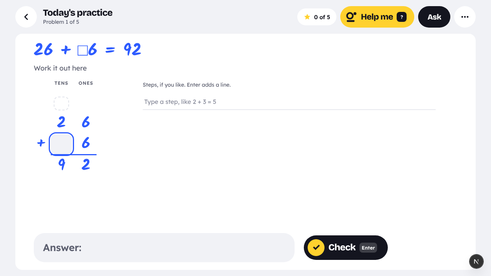
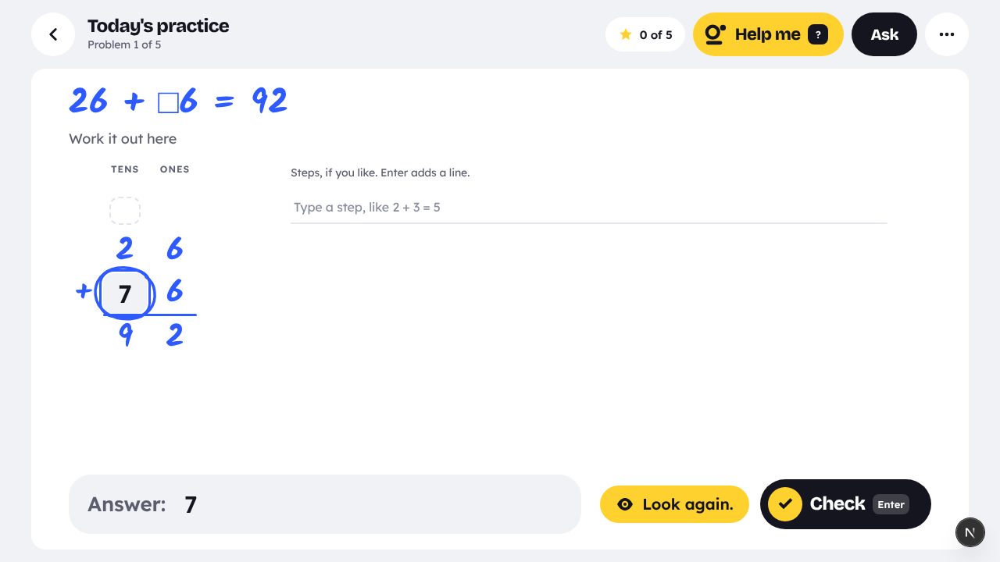
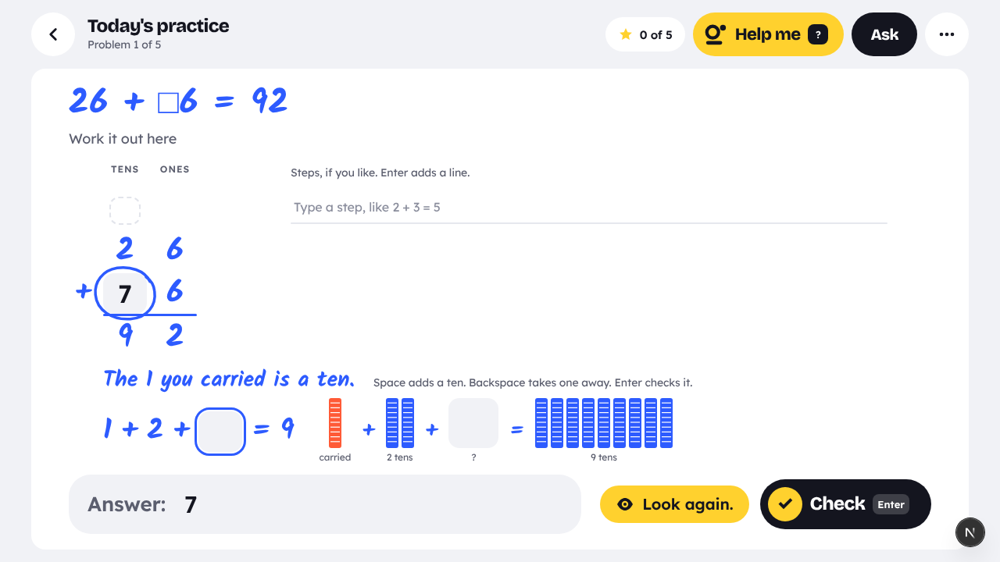
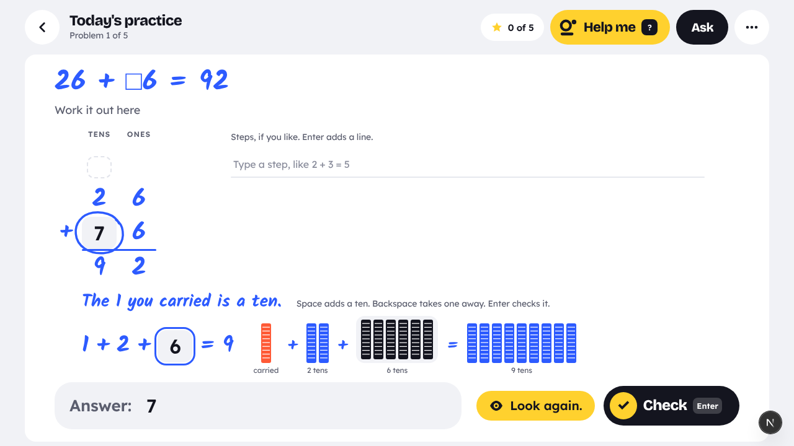
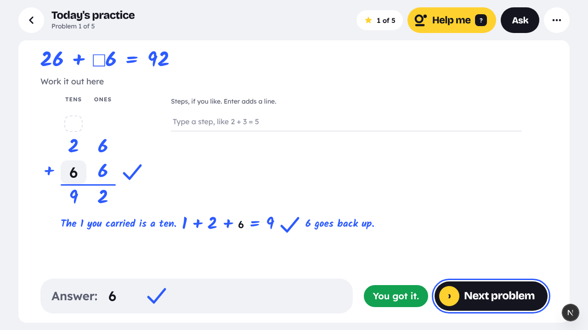
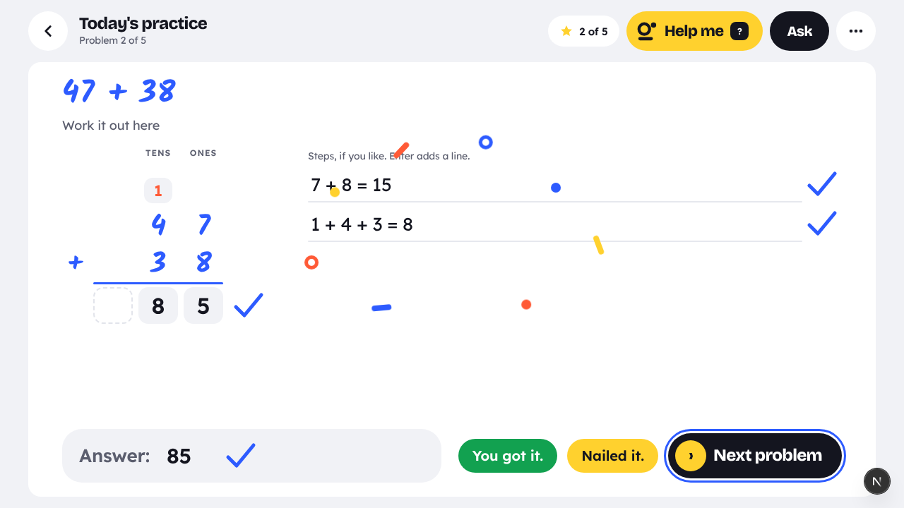
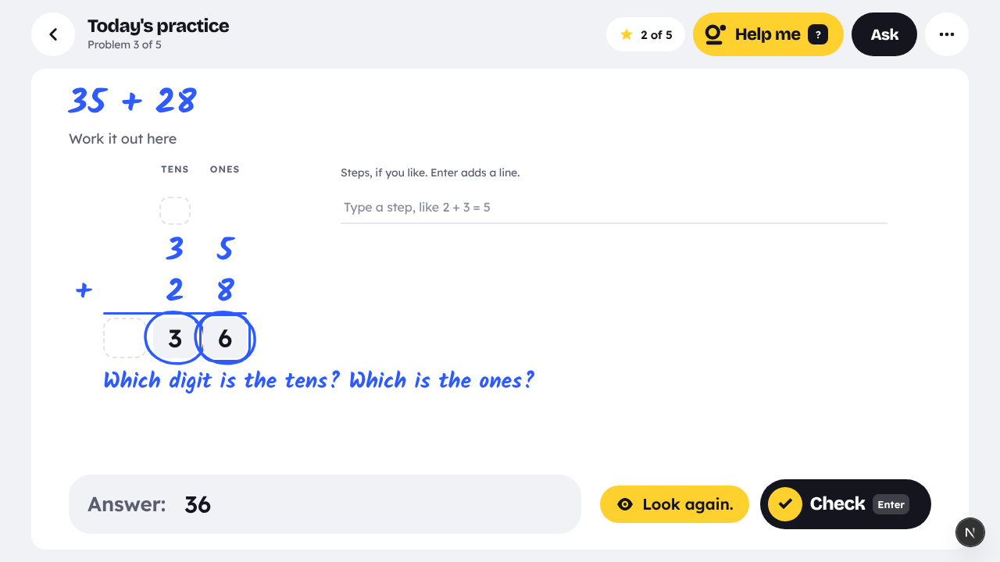
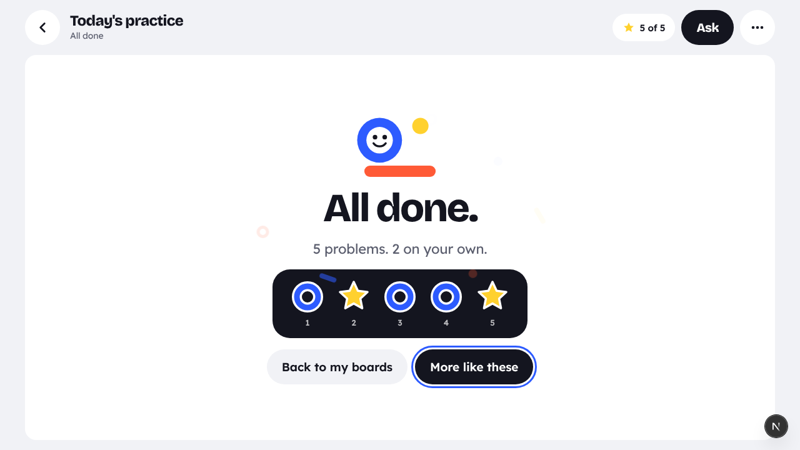

# Keys: math on a keyboard

2026-10-27, branch `feat/keys-page` (off `main`). "Keys" is a code name. Kids only ever see
"Today's practice".

Kids learn math on any laptop or Chromebook with only a keyboard: no iPad, no pen. It looks and feels
like the iPad app (Blocks, `docs/DESIGN-SYSTEM.md`; the Problem Page, `docs/PROBLEM-PAGES.md`) and uses
the same tutor, Today's practice, grade path, stars, streak, stickers and learning record.

This is not the old "Type it" (`docs/TYPE-MATH.md`, removed 2026-10-13), which typed lines onto the
tldraw board. Keys never touches the board.

## Owner decisions

- **Web first.** The iPad with a keyboard comes later, from the same engine (`src/lib/keys` is pure
  TypeScript with no DOM, so it can go into the brain bundle).
- **Grades 1 to 6 arithmetic first.** Algebra later.
- **"Keys" is a code name.** Kids see "Today's practice".

## The competitor (what we do not copy)

A competitor app has two panels: the question on the left with a single blank box, and a named mascot
tutor on the right with voice controls. A wrong answer gets "Let's look again" and a smaller problem
(blocks, `3 + [ ] = 9`), and the big problem waits.

What it does well: it shrinks the problem to the broken step, and it uses manipulatives.

Where it falls short:

- Fill-in-the-box only. The kid never shows steps.
- Help sits in a side panel, not on the work.
- A chatty mascot.
- Nothing ties it to a daily habit or a parent's view.

We copy none of its look, names or copy. No mascot, no orb, no two-panel split.

## The screen: the iPad's Problem Page, typed

- **Top bar.** A round back button; "Today's practice" with "Problem 2 of 5" under it. On the right:
  the stars pill ("1 of 5"), the sunny Help me button, the ink Ask button (Phase 2; inert for now)
  and More.
- **One white page** (radius 18) on the chalk ground (#F1F2F6). The problem at the top in the tutor's
  hand: Kalam Bold, cobalt #2D5BFF. Under it, "Work it out here" and ruled lines.
- **The kid types on the lines.** Each Enter adds a line, in kid ink #14151F (never cobalt), set in
  Lexend with tabular numerals. A column problem (`26 + ?6 = 92`) shows as a real column: place-value
  headers, a carry row (carries in tomato #FF5A36), digit cells filled right to left. Fractions stack
  when `/` is typed (Phase 3).
- **"Answer:"** row at the bottom of the page.
- **Checked when done,** like the iPad: on Enter in the answer row (or Ctrl+Enter), never while the
  kid thinks. A right line gets a cobalt tick in the margin. The line that broke gets a cobalt ring
  and the yellow "Look again." banner (sunny #FFD12E with an eye icon). Never red, never the word
  "wrong".
- **Wins** reuse the iPad's: "You got it." (success green), the "Nailed it." pill, stars filling the
  pill, and a celebration at the end of a set.

## Better than the competitor

1. **Kids show their work, typed.** Steps go on lines, not in one box, so the tutor knows where it
   went wrong.
2. **The tutor knows why, from the step.** A library of buggy rules: pure functions that produce the
   wrong answer from the item. A rule that matches the kid's answer names the cause. Exact, testable
   and free. The LLM is only a fallback, and writes wording (Phase 2).
3. **Help happens on the page, in the tutor's hand.** Under a ringed line the tutor writes a smaller
   problem in cobalt Kalam ("The 1 you carried is a ten. 1 + 2 + ? = 9"), with base-ten blocks when
   they help. The kid solves it on its own line, and the tutor carries the answer back up into the big
   problem. No side panel, no mascot.
4. **A help ladder** on Help me: a nudge, then a smaller problem, then a worked step (Phase 2).
5. **Keyboard first, all the way.** Arrows and Tab move between cells. Digits fill a column right to
   left. `c` opens a carry cell. `?` is Help me. In the blocks, Space adds one and Backspace takes one
   away. Screen-reader labels on every cell; works at large text sizes.
6. **Built into the habit** (Phases 2 and 4). It is Today's practice on a laptop, with the path,
   streak, stars, stickers, "Now you try", spaced comebacks and Progress for parents.

## Architecture

```
src/lib/keys/          pure TS, no DOM, vitest
  item.ts      MathItem: a layout (columns | equation) of cells {id, role: digit|carry|blank|given, expect?, value?}
  generate.ts  MathItems from a SKILLS id + seed (the learning generators' seeded Rng)
  check.ts     the exact check of each line and cell -> { ok, wrongCells, firstBadLine, marks }
  bugs/        buggy rules by area; matchBug(item, answer) -> bug id | null
  shrink.ts    (item, bug, cell) -> SubStep: a smaller MathItem + a manipulative + a copy key
  stack.ts     a sub-step under its line; its answer flows back into the parent
  session.ts   working -> look again -> helping (nudge | smaller) -> back -> done; the set of 5
  keymap.ts    the keyboard map: a key on a slot -> an intent; moving around the column
  copy.ts      every word the kid reads (fixed copy, no LLM in Phase 1)
src/components/keys/   KeysPage, ColumnCells, TypedLines, TutorWriting (cobalt Kalam lines, ticks,
                       rings), BlockTray, AllDone, Blocks fonts and styles
src/app/(platform)/keys/page.tsx
src/app/api/keys/say/route.ts   (Phase 2) tutor wording via src/lib/brain, with the fixed copy as fallback
```

**Design tokens on the web.** Chalk ground, white page, Bricolage Grotesque ExtraBold headings,
Lexend for the body and the kid's numbers, Kalam in cobalt for the tutor only. Flat: no gradients, no
shadows, no borders except the one hairline #E2E4EB. Capsule buttons, 56 px targets. The web app did
not load these faces, so the Keys page loads all three with `next/font`
(`src/components/keys/fonts.ts`); no other page ships them.

## Phases

1. **A slice** (below).
2. **The tutor and the record.** Tutor wording via the LLM; the help ladder; the learning record
   (`AttemptRecord` with origin `keys`, bugs mapped to mistake kinds); Now you try; stars and
   stickers saved.
3. **Breadth.** Subtraction with regrouping, times tables, multi-digit multiplying, fractions,
   one-step equations, about 25 bugs, fraction bars and a number line.
4. **The habit.** Home's Today's practice opens Keys on laptops; spaced comebacks; Progress;
   Chromebook QA; an accessibility audit.

## Phase 1: what is built

- **The engine** (`src/lib/keys`) for two-digit adding with carrying (`add_within_100`): two kinds of
  problem, `47 + 38` (fill in the sum) and `26 + ?6 = 92` (find the missing digit), both as columns.
  The generator, the exact checker, four addition bugs, a shrink for "forgot the carry" (base-ten
  blocks and `1 + 2 + [ ] = 9`), the stack and the carry back. Tests for all of it, including the
  whole journey: `26 + ?6 = 92`, the kid types 7, forgot the carry, a ring and "Look again.", Help me,
  the smaller problem, 6, carried back up, a tick, "You got it.".
- **The page** `/keys`, behind the Feature Labs switch "Keyboard practice". The Problem Page above with
  fixed tutor copy (no LLM), a set of 5 problems with the stars pill, usable with the keyboard alone,
  laid out for 1280 × 720 (a Chromebook) and readable narrower.
- Nothing is saved yet. The learning record, stickers and the streak come in Phase 2.

### The bugs (`src/lib/keys/bugs/addition.ts`)

| id | what the kid did | `47 + 38` | `26 + ?6 = 92` | mistake kind |
|---|---|---|---|---|
| `add_forgot_carry` | wrote the ones digit and dropped the 1 | 75 | 7 | `arithmetic` |
| `add_carry_twice` | added the 1 twice | 95 | 5 | `arithmetic` |
| `add_whole_column_sum` | wrote each column's whole sum (`7`, `15`) | 715 | none | `concept` |
| `add_swapped_places` | swapped the tens and the ones | 58 | none | `concept` |

A rule that would give the right answer (`44 + 33` swapped is still 77) never matches. The first
matching rule in this order wins. The mistake kinds are for Phase 2's learning record.

### The check

- A kid cell left empty is not judged. A filled one is right or not.
- A carry cell is optional. Filled, it must hold the carry (or 0 where none is due).
- The answer is the answer row, or the column's answer when the row is empty. Nothing to judge:
  "Write your answer first. Then press Enter."
- Enter in the column fills the answer row from it, and the row then follows the column (a fixed
  cell fixes the answer too) until the kid types in the row.
- Ticks on right lines (the column's answer line, a missing digit's line, a true typed step, the
  answer row). A ring on each cell that broke, and on a false typed step. The answer row gets no mark
  when it only carries a slip from the column, as on the iPad.
- A typed step (`6 + 6 = 12`) is judged as a sum: true gets a tick, false a ring. A line without an
  `=`, or one that ends in `=`, is not judged.
- Typing in a checked line takes its mark off; the line waits for the next check.

### Help me (`?`)

1. Not checked yet: it checks first.
2. "Forgot the carry": the smaller problem under the column, in the tutor's hand, with base-ten
   blocks (the carried ten in tomato, the tutor's tens in cobalt, the kid's in ink). The kid answers
   it by typing a digit or by building rods (Space adds, Backspace takes away). Enter checks it. Right:
   a tick, the answer goes back up into the cell that broke, and the big problem is checked again.
3. Any other bug, or none: a one-line nudge in the tutor's hand under the column
   ("15 ones is 1 ten and 5 ones. Write the 5. Carry the 1.").

### Stars

Each problem ends one of three ways: first try, fixed after a "Look again." (both a star: done on your
own), or with help (a ring). The pill counts problems solved. All done shows the set's stickers,
"Back to my boards" and "More like these".

### Keys

| key | where | does |
|---|---|---|
| 0–9 | a column cell | fills it, then moves one cell left (right to left) |
| 0–9 | a carry cell | fills it, then goes back down to that column |
| `c` | a column cell | opens the carry cell over this column (or the next one left) |
| ← → ↑ ↓ | the column | moves between cells; ↓ from the bottom row goes to the lines |
| Backspace | a column cell | clears it; on an empty cell, moves back right |
| Enter | the column | goes to the answer row, filled in from the column |
| Enter | a typed line | adds a line under it |
| ↑ ↓ | the typed lines | moves between lines, the column and the answer row |
| Backspace | an empty typed line | removes it |
| Enter | the answer row | checks |
| Ctrl+Enter (⌘+Enter) | anywhere | checks |
| `?` | anywhere | Help me |
| Space / Backspace | the smaller problem's box | adds a rod / takes one away |
| Enter | the smaller problem's box | checks it |
| Enter | after "You got it." | the next problem |

More (⋯) shows this list on the page.

### Trying it

Turn on "Keyboard practice" in Feature Labs (or with the button on `/keys`). The set is seeded by the
date. QA helpers: `/keys?seed=42` picks another set; `/keys?p=26+?6=92|47+38` gives exactly these
problems (`+` may be written as `%2B` or a space).

### Screenshots

Chromium at 1280 × 720 (a Chromebook), driven by the keyboard only, on the local dev server
(`docs/qa-screenshots/keys/`):

| | |
|---|---|
|  |  |
| **The page.** `26 + ?6 = 92` in the tutor's hand, the column, steps, the answer row. | **7, Enter, Enter.** The box is ringed; "Look again.". |
|  |  |
| **`?` (Help me).** The smaller problem under the column, with tens to build. | **Space six times.** Six tens in ink; the box says 6. |
|  |  |
| **Enter.** 6 goes back up, a tick, "You got it.", Next. | **`47 + 38` on the first try,** with a carry and two typed steps, each ticked. |
|  |  |
| **Swapped digits.** No smaller problem for this bug yet: a nudge. | **All done.** A star for each problem done alone, a ring for one done with help. |

Also: `keys-00-gate.png` (the Feature Labs gate), `keys-10-sum-carried-back.png` (an answer typed
on its own, patched by the carry back), `keys-12-keys-card.png` (More: the keys),
`keys-13-narrow-760.png` (760 px wide).

## Status

| phase | status |
|---|---|
| 1. A slice | done (`feat/keys-page`) |
| 2. The tutor and the record | done (`feat/keys-full`) |
| 3. Breadth | see below |
| 4. The habit | see below |

## Phase 2: the tutor's voice and the record

### The help ladder (`session.ts`)

Help me (the button or `?`) climbs one rung for the slip on the page. A different slip (another bug
or another line) starts the ladder again; a slip fixed and checked keeps its rung.

1. **A nudge**: one line in the tutor's hand under the work (`nudgeFor`), and a cobalt arrow under
   the column that broke (the place head turns cobalt too). For a slip no bug rule names, the page
   asks the board's check endpoint for its words (below).
2. **A smaller problem** (`shrink`): written under the line, with its blocks; solved, its answer
   goes back up. A bug with no smaller problem goes straight to rung 3.
3. **A worked step** (`workedFor`): the column worked out in the tutor's hand ("1 + 7 + 8 = 16.
   Write the 6 in the ones. Carry the 1 to the tens."). The kid still types it. A smaller problem
   that is open stays open under it.

At the top, Help me does nothing more. Help me before any check checks first, as on the iPad.

### The tutor's words (`/api/keys/say`, `src/lib/keys/say.ts`)

The page always knows what to say: the fixed line from `copy.ts`, worked out from the item, the bug
and the rung. `POST /api/keys/say` only says it another way, in a coach's voice for the kid's grade
(`src/lib/server/prompts/keysSay.ts`), on the small fast model that names boards (`LIVE_MODEL_TITLE`),
one attempt, 1.4 s. **The judgement never comes from the model.** A reply is kept only when it is
`sayable`: the same numbers (none added, none lost), short, plain (no LaTeX, no emoji, at most one
exclamation mark) and none of the words the tutor never says ("wrong", "mistake", "easy", "oops"…).
Otherwise, and on any failure, the route answers the fixed line (200, `source: "copy"`). The page
waits at most 1.5 s (`SAY_WAIT_MS`, the tutor's "…" meanwhile) and then shows the fixed line. Lines
said once are kept (on the server and on the page), so the same help says the same words.

The route: `livePreamble` (the signed-in kid, the `keysSay` bucket, 30 a minute, zod), uncharged. It
uses the server's model plumbing like the other Live routes; `src/lib/brain` is the iPad's bundle of
the board's logic, and `src/lib/keys` stays pure so it can join it later.

**A slip no bug rule names** (`src/lib/keys/hint.ts`): the nudge's fixed words show at once, and the
page asks `POST /api/live/check` (the tutor that checks handwritten work; charged like any check, it
is a Help me) for a hint about the line that broke. The request is the problem and the kid's typed
lines, each with the page's own verdict, focused on the line that broke. Its first warning replaces
the nudge's words, unless it would give the answer away; nothing within 6 s: the fixed words stay.

### The learning record (`src/lib/keys/record.ts`, `useKeysRecord`)

One `AttemptRecord` per problem, origin **`keys`** (a new `ATTEMPT_ORIGINS` value; the check
constraint is replaced by `supabase/migrations/20261027030000_keys_origin.sql`), `boardId` null,
saved with `store.saveAttempts` as it goes (a moment after a change, at once when solved, as
`unfinished` when the kid moves on or leaves). A problem is recorded once it was checked or helped.

- **Outcome:** the learning system's own `outcomeOf` over the counts: no help and no ring is
  `first_try`, a ring fixed alone is `self_corrected`, any rung of help is `with_help`. The stars on
  the page say the same thing.
- **Counts:** lines written (column lines, typed steps, the answer row, smaller problems answered),
  lines right (ticks), lines ever ringed, hints (nudges), tutor steps (smaller problems and worked
  steps), asks (Help me's that gave help).
- **Mistakes:** each named bug's kind (`BugRule.mistake`) once per problem; a slip no rule names is
  `arithmetic` (a number slip).
- **Problem:** the item as LaTeX (`26 + \square 6 = 92`), skill the item's.

Progress, the parents' view, mastery and the tutor's learner hint read these rows with the rest.

### Now you try, stars, stickers

- **Now you try** (the iPad's rule, `nowYouTry.ts`): after a problem done with help, "Now you try
  one" (focused; Next is beside it) puts one more like it right after it: the same kind, new numbers,
  a different answer, the same one for the same attempt (`variantItem`, seeded with `seedOf(attempt
  id)`). Its record's `parentId` is that attempt. It is not one of the set's five: the top bar says
  "Now you try", and the stars and stickers count the set's own problems.
- **Stars** fill the pill as problems are solved (a small pop; Reduce Motion: none).
- **Stickers** on All done: a star for each problem done on your own, a ring for one done with help,
  and **5 for 5** when every one was on your own. The celebration is the shapes and the burst.

### Read aloud

Off by default. More (⋯) has the switch "Read the tutor's words aloud" (this device). When it is on,
each new tutor line, "Look again." and "You got it." are said through `/api/live/speak` (the
browser's own voice when the route cannot), with Keys' own speaker (`src/components/keys/tutorVoice.ts`,
not the board's read-aloud module, which listens to the tldraw board). The words are always on the
page: the captions are the tutor's lines themselves.

### Not yet

- The Ask button (inert, "Ask is coming soon.").
