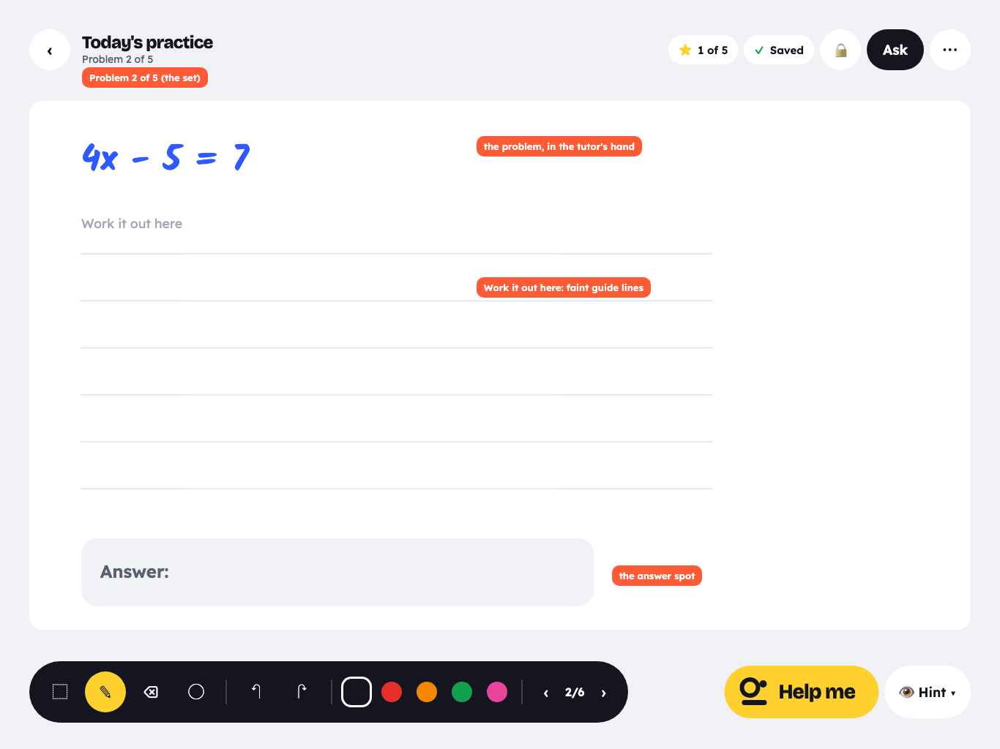
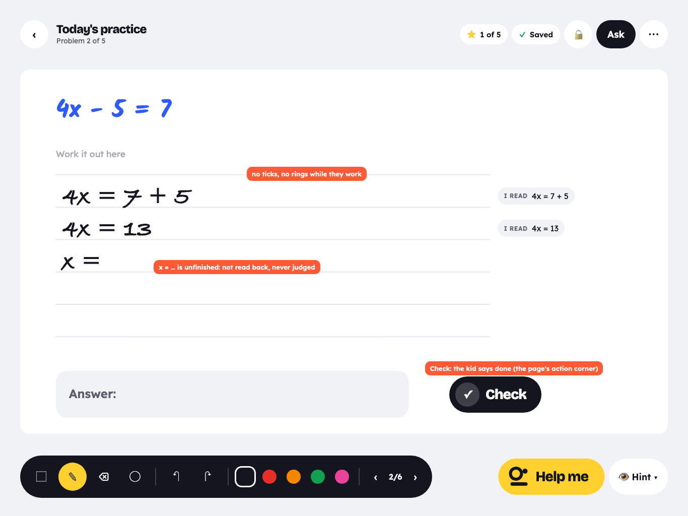
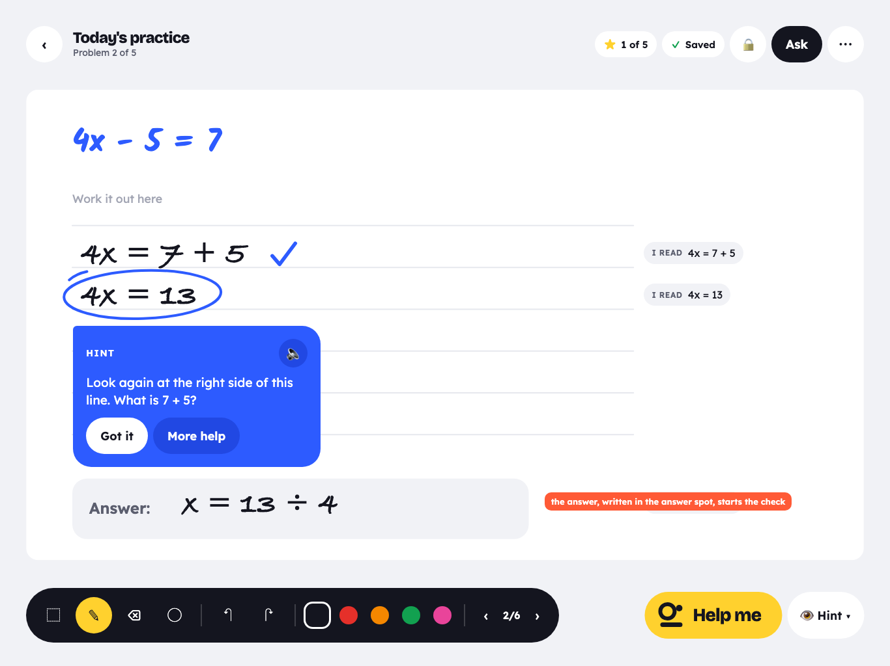
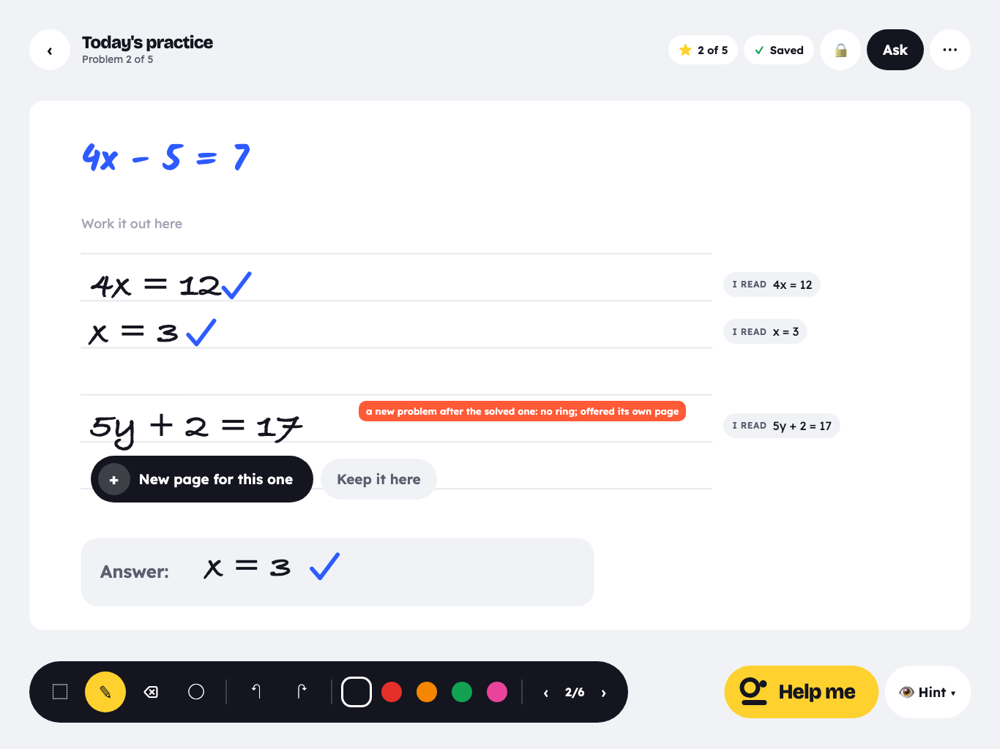
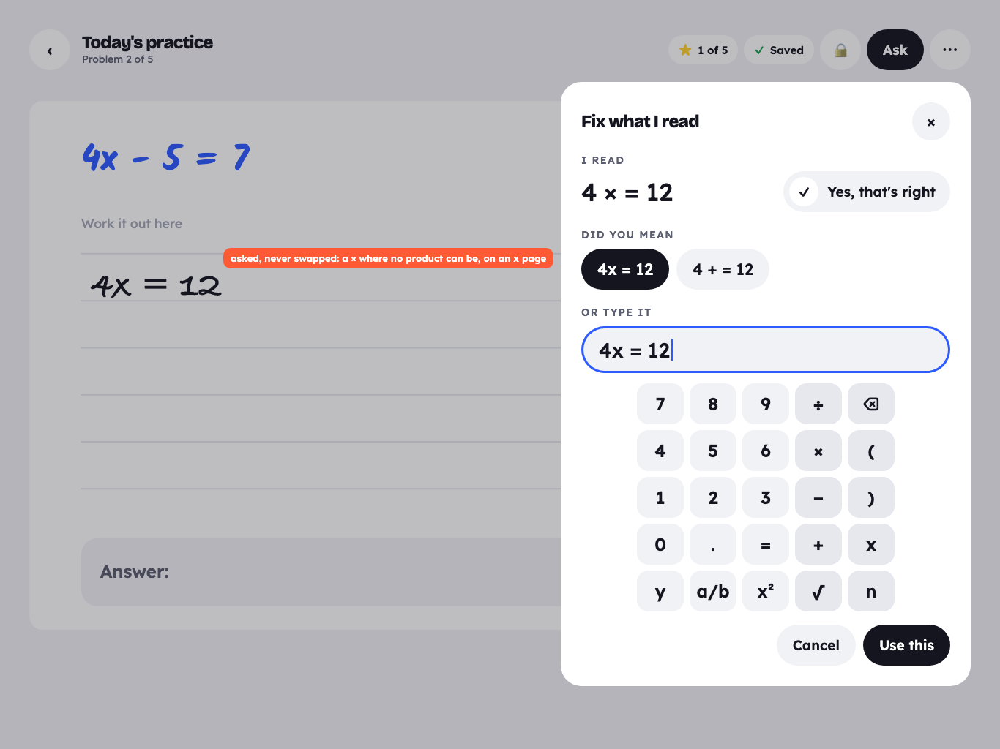
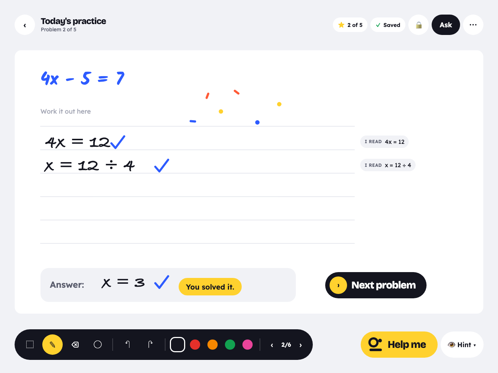
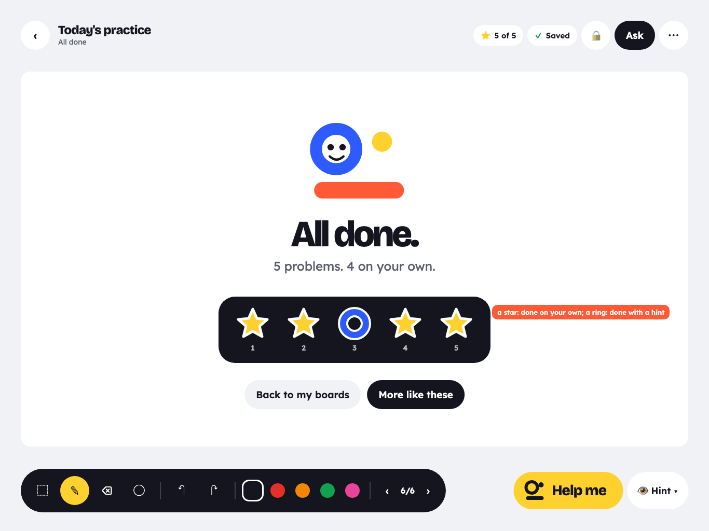

# Problem pages: one problem a page, checked when done (iPad)

2026-10-19, branch `feat/ipad-pages` (the PROBLEM PAGES lane, off `feat/ipad-integrate`). Mockups:
`docs/problem-pages/mock-*.png` (Blocks, iPad Air 13" landscape, drawn in page units by
`docs/problem-pages/mockups.html`; `./render.sh` renders them again).

## Rollout (2026-10-19)

The owner, on the iPad: "we need 1 question per screen or some way to not leak one handwriting into
another" (Today's practice had written five problems on one page; #1's work ran into #2). So the
pages shipped first, alone, and the second part followed the same day:

- **The pages:** every problem the tutor gives on its own page (the problem at the top in the tutor's
  hand, the work area under it), "Problem n of N", Next once solved, the dock's ‹ › as before, All
  done at the end (Back to my boards, More like these), and the tutor judging a page's ink against
  that page's problem only.
- **The second part, on** (`ProblemPagesRollout.secondPart = true`, Release too; Debug
  `-pagesFirstPartOnly` turns it off for a run): check when done is the default, with the grown-ups'
  switch back to "As they go" (per board); the answer spot; "I read" and tap to fix; the page's own
  judging rules (true steps, partial answers, the kid's own problem, never ringing a read in doubt) and
  "New page for this one". The owner had decided each of these; the switch was flipped once the
  three-page journey passed on the local stack.
- **The second opinion stays off** (it doubles Mathpix's calls per line; the owner's call): the
  server's `RECOGNIZE_SECOND_OPINION` and, for this iPad in a Debug build, the Live Lab's "Second
  opinion" switch.
- **Continuation rules** (`+3 = 767` under `400 + 364 = 764`, trailing equals, chains…) are the
  integration's (`ContinuationLine`, the web's rules ported with their tests); the page review sits on
  top of them and adds none of its own.

## Why

A parent, about the web app:

- "I couldn't get the letters to be recognized as an adult, no way my son would get there."
- "My son was unclear how to use the white space because some problems required multiple steps versus
  direct answers."
- "He was afraid of writing an intermediate step because the app immediately marks it as incorrect."

The owner's calls (2026-10-19):

1. **One problem per page.** Every problem the tutor gives goes on its own page: the problem at the top
   in the tutor's hand, a "Work it out here" area with faint guide lines, an answer spot at the
   bottom. A set says "Problem 2 of 5"; solved, a cheer and a big Next; the set ends on "All done". The
   tutor judges all the ink on a page against that page's problem, never across pages.
2. **The kid's own problems.** A second problem started on a page is *offered* a page of its own ("New
   page for this one"); one tap moves it, as one undo step. Nothing moves without a tap.
3. **Check when done** (the new default; grown-ups can switch back to "as I go"). The tutor is quiet
   while the kid works and checks when the kid writes in the answer spot, taps Check, or stops for a
   long pause. Then: small ticks on right steps, a gentle ring and a hint on a real slip. Never judge an
   unfinished line; never ring a true step because it isn't the answer yet.
4. **Trust in reading.** Each line shows a quiet "I read: 2x + 3 = 11" that can be tapped to fix (pick a
   reading or type it); a fixed reading checks the line again and is remembered for that line. Letters
   read in the page's context.

## What the kid sees

| | |
|---|---|
|  |  |
| **The page.** Today's practice, problem 2 of 5: the problem in the tutor's cobalt hand, "Work it out here" over faint guide lines, the answer spot. | **Working.** Steps go down the lines. The tutor reads every line ("I read" in the margin) but marks nothing. `x =` is unfinished: not judged. Check sits in the page's action corner. |
|  |  |
| **Checked** (the answer written in the answer spot started it). A small tick on the right step, one gentle ring on the slip and a hint card. The answer carried on from the slip gets no mark of its own. | **A second problem.** After the solved problem the kid starts `5y + 2 = 17`: no ring (it is not a step of this problem), and an offer of its own page. "Keep it here" keeps it, judged as its own problem. |
|  |  |
| **Tap to fix.** `4x` read as `4 × =`. The sheet offers the reading the page's problem makes likely, or a maths keypad. | **Solved.** The cheer, and Next problem in the action corner. |
|  | |
| **All done.** The set's stickers (a star: done alone; a ring: done with a hint), Back to my boards, More like these. | |

## The page (AgathonBoard)

A problem page is an ordinary `screen` record with a `page` object in its `meta` (a new meta key, so no
schema bump: BOARD-FORMAT.md, "When to bump"):

```json
"meta": { "page": {
  "kind": "problem",            // "problem" | "done"
  "set": "daily:2026-10-19",    // the set (the practice key, "ask:<uuid>", "nyt:<seed>"); absent on a kid's own page
  "index": 2, "count": 5,       // its place in the set (1-based); absent on a kid's own page
  "problem": "problem:k3Vb…",   // the page's problem record, once written
  "origin": "practice",         // practice | chat | nowYouTry | student
  "workTop": 186                // where the work area starts (under the problem as written)
} }
```

`ProblemPage` (Swift, AgathonBoard `Model/ProblemPage.swift`) reads and writes it; `ProblemPageLayout`
holds the geometry. Everything is in page units on the 1600 × 900 screen:

| part | where (page units) | look |
|---|---|---|
| the problem | origin (88, 60), up to x 1512; the tutor's hand at 48 (the desk's problem size), shrunk to fit | cobalt, the tutor's hand (Kalam stands in, in the mockups) |
| problem area | 60 … the problem's ink bottom + 20, at least to y 170 | nothing drawn |
| "Work it out here" | at (88, workTop + 30), 22 | Lexend, a flat light grey (#A3A6B4) |
| work area | workTop … 720; `workTop` = problem area bottom + 16 (186 for a one-line problem) | |
| guide lines | every 80 from workTop + 74 down to ≤ 720 (6 for a one-line problem: 260 … 660), x 88 … 1160 | 2.5 wide, #E6E8EE, round caps: lined paper, about 12 mm apart on a 13" iPad |
| the margin lane | x 1180 … 1512 | nothing drawn; the readbacks line up here |
| the answer spot | (88, 744), 872 × 116, radius 28 | flat chalk (#F1F2F6); "Answer:" in Lexend SemiBold 30, ink secondary |
| the action corner | (1000, 744) … (1512, 860) | nothing drawn; Check and Next sit here (view space) |

A three-line word problem pushes `workTop` to about 316 (5 guide lines). The work area keeps at least
two rows: a problem taller than 420 shrinks its hand (the desk's own rule, down to 28).

**Drawn by the canvas, not as ink.** `BoardCanvasView` gets a `templateLayer` between the paper and the
ink tiles (page space, under the camera): flat shape layers and two text layers, rebuilt on
`sceneReset` and when the screen's `page` meta changes. The template is never a record: it is not
erased, selected, clustered, read, saved as strokes, or sent to Ask's picture. The thumbnail draws it
too (one faint pass), so Home's card looks like the page. Colours come from `CanvasAppearance`
(`templateGuide`, `templateLabel`, `templateAnswer`), set by AgathonBoardUI from Blocks.

**The "All done" page** is a screen with `page.kind = "done"`: blank paper, and the app draws its card
over it (the set's outcomes come from the learning record, so they are live, not ink). Help me hides
on it.

**The top bar** (AgathonBoardUI `BoardTopBar`): on a problem page in a set the subtitle is "Problem 2 of
5" instead of "Page 2 of 6" ("All done" on the done page); elsewhere "Page n of N" as now. The dock's
‹ n/N › and the Pages sheet still count pages.

## Writing problems on pages

Every source writes through one Swift entry point, `ProblemPageWriter` (AgathonAsk; it owns the desk),
which for each problem: makes or reuses a fresh page, stamps its `page` meta, writes the problem in
the tutor's hand at the problem origin, and makes the page's `problem` record.

| source | today | with pages |
|---|---|---|
| Today's practice, a topic (`BoardTutor.writePractice`) | one `write_problems` action: the desk's grid, 6 a screen | one page per problem. A fresh board's first (blank) screen is page 1; the rest are added after it; then the All done page. `documentMeta.practiceWritten` still stops a second write |
| Ask's `write_problems` ("3 more like these", weak spots, any problems the chat writes) | the desk's grid on a fresh screen | one page per problem, inserted right after the page the kid is on, then All done (sets of 2+); the board moves to the first |
| Now you try (`LiveLoop.writeProblem`) | under the work if there is room, else a new screen | always its own page, right after this one (`origin: nowYouTry`, no set, no All done) |
| the onboarding's first board | the try's problem and its tick | unchanged (it is one problem on one page already; it gets no template, so the carried tick stays where it is) |

**How a problem is written.** The desk (the web's `ChatDesk` in the brain, unchanged) still checks
every problem (`verifyProblem`: the engine reads it, it is solvable, the hand can draw it). The writer
runs it once per problem with a single-problem `write_problems` on the fresh page, then, in Swift,
takes the desk's planned block, drops the problem number it writes before a grid cell ("1."), and moves
the block to the problem origin; the `chatProblem` meta's `cell` becomes the whole page. So nothing in
the brain changes (no `brain.js` rebuild), and the strokes still carry `chatProblem` (Ask's
`help_problem`, the learning record's chat cells and `LiveLoop+Problems` all keep working; `n` is 1 on
every page, which is what Ask's picture of that page says too). A problem the desk refuses gets no page
("Problem 2 of 4"); at the 50-page cap the rest are left out, as the desk says today.

**Word problems (2026-10-22).** The desk writes maths only (`verifyProblem`'s `words`), so a problem in
sentences ("Sam has 3 bags of 4 apples. How many apples?") used to get no page at all — the Training
Center's 30 word-problem pages never started. Real kids did not hit it: the chat route repairs or drops
a word problem before it reaches the board, and practice sets are generated as maths. Now the writer
gives a word problem the desk refused its page too (`WordProblem`, AgathonLive): its sentences as plain
words (`\text{}` unwrapped, `\frac{3}{4}` as 3/4, `\times` as ×; a command it has no words for keeps
the problem out, so nothing ever shows as LaTeX), written in the tutor's hand at the problem origin by
the brain's `layoutWords` (`planWords`: the hand's `composeHandwriting`, wrapped at the rules' width,
48 down to 28, a word gap that grows with the hand), the work area under them. The words carry
`wordProblem: true` and no `chatProblem`: they head no column. The kid's first line under them
(`3 \times 4 = 12`) is the problem their work is judged against, as on a page of their own homework,
so a slip in the sums is still ringed; whether the set-up matches the words is theirs. With the hand
off the sentences are typeset as `\text{}` rows of at most 48 characters. The web writes no word
problems, so nothing changes there; `layoutWords` is new in the brain and nothing on the web calls it.

## One page, one problem (AgathonLive)

**The page's problem heads every column on the page.** `anchorAtProblems` today homes a line to the
problem above it and drops the link 360 units down; on a problem page every line's home is the page's
problem, wherever it is (side work in a second column included). Lines on other pages are never
looked at: the loop already works on the current screen only, and so do Ask's picture and the
learning keys (`<screen>#cell:<problem>`).

**A second problem on a page.** A line starts a new problem (never a ring) when it is a relation
(`equation`, `inequality`) that does not follow from the work above, and:

1. it comes after a solved line in its column (the problem is finished: this is the next one), or
2. its letters share none of the page problem's letters (`5y + 2 = 17` on an `x` page), or
3. on a page with no problem of the tutor's (a free page), it heads a second column of its own work.

A same-letter line that does not follow, with the problem unsolved, is a slip, as now (`x = 5`). On a
problem page (and on a free page, once per page) the new problem's first line gets the offer: a big ink
**New page for this one** under it, and a quiet **Keep it here**.

- **Tap:** its lines (the head and every line after it in its column; a whole column under rule 2 or 3)
  move to a new page right after this one, as one kid undo step (`BoardController.moveToNewScreen`: the
  screen and the strokes' new `screen` and position in one transaction; the old page's `line` and
  `mark` records for those lines and the tutor's marks on them go in the same step). On the new page
  the kid's first line is the problem (`origin: student`, a template under it). The board goes there;
  the lines are read from the recognizer's cache (the payload is normalised to the line's own box, so
  moved ink hashes the same: no new reads).
- **Keep it here** (or ignored): the problem stays and is judged as its own, its first line heading
  the lines under it. The offer does not come back for that problem.

## Check when done

`LiveSettings.checking`: `.whenDone` (default, also for settings saved before it existed) or `.asIGo`
(today's behaviour). For grown-ups: "Check the work: When they're done · As they go".

### What happens

```
            kid writes (reads go on: "I read" under each line)
   WORKING ◄─────────────────────────────────────────────┐
   (quiet)                                               │ new ink in a checked line
      │ Check tapped                                     │ (its mark comes off; the line waits again)
      │ the answer spot quiet 1.5 s                      │
      │ 9 s with no ink (Auto on)                        │
      │ Help me (that line's column)                     │
      ▼                                                  │
   CHECKING ── reads in flight and the quiet gate        │
      │        finish first (at most 7 s)                │
      ▼                                                  │
   CHECKED: every finished line released ────────────────┘
      ticks on right steps, no mark on a line carried from a slip,
      the first slip: a gentle ring + a hint card, a "?" on a line it could not read,
      solved: the cheer, and Next on a problem page in a set
```

Per line the loop keeps `released[lineId] = latex` (also on the line record, `meta.checked`, so a board
opened again keeps its marks without a new check). A line is **held** while the setting is When done
and its reading is not the released one. `render` of a held line writes no mark, no "?", no step
beside it, no answer after its `=`, no "Graph it", and tells the learning record nothing; the read,
the analysis and the "I read" chip go on as now. Auto's model checks and its stuck step look only at
released lines.

### Triggers and timings

| trigger | when | notes |
|---|---|---|
| **Check** | tapped | in the action corner; shown while the page has read lines not yet released. Nothing to check: "Write your work first, then tap Check." |
| **the answer spot** | a line whose middle is in the answer spot, read, and no ink in the spot for 1.5 s (`answerQuietMs`) | the extra beat stops `12` being judged as `1`; any time, Auto on or off |
| **a long pause** | 9 s (`checkPauseMs`) after the last kid stroke on the page, the pen up | Auto on only (Auto off waits for Check, as it waits for Help me) |
| **Help me** | tapped | releases the target line's column first, then helps as now |
| **the safety net** | Auto on: 12 s (`checkPauseMs` + `safetyMarginMs`) after the last kid ink, read lines still held and nothing being read | once per stretch of ink; a pen still reading as down by then is a touch left on the board (a resting palm), so the line under it is checked too; why the work was held goes to the log and the Debug probe (`why … net[…]`). Added 2026-10-19 after the journey twice left an answer held with Check showing |

### What a check does

1. Lines still being read, or waiting in the quiet gate, are read now; the check runs when they land.
2. **Unfinished lines are left out** (they stay held): an `incomplete` read (a trailing `=` or operator,
   an answer started: `=`, `-`), a line still being read, and the line the pen is on (a stroke in it
   less than 1.2 s ago, `unfinishedMs`) when the trigger was the pause or the answer spot.
3. Every other line on the page is released and rendered: a small tick on a right step (the engine's
   step equivalence: `4x = 7 + 5` under `4x − 5 = 7` is right), none on a line carried from a slip, a
   ring on a real slip.
4. **One hint:** the first slip on the page gets a hint card at once (the dial's Hint words: the
   engine's note, else the iPad's words, else one `/api/live/check`). Other slips are ringed, no card.
   Suggest and Solve then do what they do after a ring (the right step beside it, once the kid stops).
5. **Solved** (a line ticked as solving the page's problem): the cheer and, on a problem page in a
   set, **Next problem** (or **All done** on the last) in the action corner. Next goes to the next page.
6. Unread lines get the "?" and their chip says "Tap to fix".

### The new judging rules (both settings)

- **Never judge an unfinished line** (above).
- **Never ring a true step.** A line the engine rings (or the model flags) is not a slip when it is true
  on its own: a closed arithmetic fact (`3 × 4 = 12`), an identity (`2(x+1) = 2x + 2`). It gets no
  ring (a tick when it is also a right step of the problem).
- **A partial answer is not a slip.** `x = 2` under `x² − 5x + 6 = 0` (one root of two: the engine says
  mismatch today) is ticked, not solved, and the check says "That's one answer. Is there another?"
  (`verifyExpected(root, line)` for each of the problem's solutions).
- **Steps are judged as steps.** Unchanged: a line is right when it follows from the last right line
  (equivalent transformations are right; the engine's root comparison), a step that follows from a
  ringed one is "carried", unmarked.
- **A bare number in the answer spot** answers the problem's one letter: `3` under `4x − 5 = 7` is
  judged as `x = 3` (today a lone `3` is a label, never judged).
- **A new problem is never ringed** (above), nor is a line the loop cannot place (as now).

## Trust in reading

Input (2026-10-19): the Mathpix SuperNet-201 eval (`docs/eval/mpx-supernet.md` on `feat/ipad-app`).
Its findings that shape this: no confidence is good enough alone (SuperNet-201's new fields are empty
for a line crop; the vision reader's is no signal; v3/text at 0.99 still passes look-alike letters:
`a = 5` → `0=5`, `e^{x}` → `6^{x}`); the best trigger to ask the kid is the **disagreement** of the
strokes read and a v3/text read of the line's crop (asks about 2.7 % of lines, catches 71 % of
misreads; with "strokes confidence < 0.99" too, 4.5 % asked, 88 % caught); and swapping in the other
read breaks 1 % of right reads. So: **"I read" always shows, quietly; it asks only when there is a
reason; nothing is ever swapped without a tap.**

### "I read"

Every read line on the current page shows a quiet chip: **I READ** `2x + 3 = 11` (chalk capsule, the
label in caption caps, the reading in Lexend; `LiveOverlay`). It stays while the line is there (today's
readback fades after 2.5 s). Where:

- on a problem page, in the margin lane at the line's middle (x 1180, or after the line's mark when the
  line runs long), so it never sits where the next line is written;
- elsewhere, just after the line's mark slot, at its middle.

States:

| state | when | look |
|---|---|---|
| **read** | read, no reason to doubt it | chalk, quiet |
| **asking** ("Is this right?") | the two readers disagree (when the second opinion is on), or Mathpix's strokes confidence is under 0.99, or the page's context makes another reading likely (a lone `×` on an `x` page; `0` where the page's problem has an `a`) | pale sunny (flat), "Is this right?" |
| **unread** | nothing could be read (confidence under 0.6, or no read) | pale sunny, "I couldn't read this. Tap to fix." |
| **fixed** | the kid (or a grown-up) confirmed, picked or typed it | chalk, a small pen mark |

The chips hide while the pen is down and for 1 s after, so a stroke never starts on one. A grown-ups'
switch "Show what the tutor read" (default on).

**A ring needs a read the tutor trusts.** A line in **asking** or **unread** is never ringed: when a
check finds it a slip, the tutor asks first (the chip opens "Is this right?"; the hint card says "Did I
read this right?"). Confirmed or fixed, it is judged at once. A tick on an asking line is fine (a right
step stays right whatever the doubt was about).

### The second opinion (behind flags)

The disagreement trigger needs a crop of every finished line and one more Mathpix call on each
(it doubles Mathpix's cost per line), so it is off until the owner turns it on, in two places:

- **server:** `/api/live/recognize` takes `secondOpinion: true` with the line's `crop`; with the route's
  flag on (`RECOGNIZE_SECOND_OPINION=mathpix-text`, off by default) it reads the crop with v3/text in
  parallel with the strokes (≈0.2 s, inside the strokes read's ≈0.45 s) and answers
  `second: { latex, confidence }` and `agree` (the two reads the same maths as written:
  `src/lib/live/sameRead.ts`, so `3 x=15` and `3x = 15` agree and `0=5` and `a=5` do not). Flag off,
  the crop missing, the crop retry, or a second read that failed: neither field, nothing else changes.
  The second read is never the line's reading. With the v3/text crop reader on as well, a strokes
  read that came back empty takes the second read's answer as its crop read (one call, not two).
- **client:** `LiveLoop.secondOpinion` (off by default; a Debug switch in the Live Lab, then a remote
  setting) sends the crop and `secondOpinion: true` on every read. Off, the strokes-confidence and
  context triggers still work.

### Tap to fix

A tap opens **Fix what I read** (a popover on the chip; a sheet in a narrow window):

- **I read** the reading, big, and **Yes, that's right** (confirms it: the line is trusted, and judged).
- **Did you mean** up to three readings (52 pt chips), best first: the second opinion's read when it
  disagreed, the page's context (a look-alike of one of the problem's letters as that letter: `×`→`x`,
  `0`→`a`, `6`→`e`, `;`→`i`, `U`→`u`, one place at a time), the second reader's (`/api/live/reread`)
  when it differed, then the commonest confusions of a handwritten line (`X`→`x`, `1`↔`l`, `5`↔`s`,
  `2`↔`z`, `0`↔`o`, `9`↔`g`, `t`→`+`, `b`→`6`), kept only when the engine reads them as maths, a reading
  that follows from the line above first.
- **Or type it:** a maths keypad (0–9, `+ − × ÷ = ( ) .`, `x y n`, a fraction `a/b`, a power, `√`, ⌫),
  56 pt keys, no system keyboard. It writes LaTeX (`a/b` → `\frac{a}{b}`).
- **Use this** sets the line's reading: `provider: fixed`, confidence 1, the line record's meta `fixed`
  (+ the ink's hash). The payload cache and the second reader take it for that ink, so a re-read never
  undoes it; new ink in the line drops it (a new line, a new read). Then the column is analysed again
  and the line is checked again at once (released, in When done). The learning record hears the line
  with its new reading.

### Letters in context

`/api/live/recognize` does take a `hint`, but only `math | chem | physics` (it steers the vision
reader's prompt; Mathpix's strokes API has no alphabet to steer). So the page's letters are used on
this side, and only to **ask and suggest** (`ReadingContext`, AgathonLive `Logic`): the letters of the
page's problem (single Latin letters outside commands and `\text{…}`), and the look-alikes of each.
The tutor's own second reader (`/api/live/reread`, 73/100 real misreads fixed and 0/30 right reads
broken in its own eval) keeps working as today. Sending the page's letters to the server (a richer
`hint` for the readers) is a web change for later.

## The learning record

- **One attempt per problem page** falls out: every line on the page has the page problem's key
  (`<screen>#cell:<problem record>`). A kid's own page is `<screen>#ink:<head line>` as now.
- **When done** changes what the record hears: a line's mark when it is released, never a held line. A
  slip the kid fixes before checking is no mistake in the record; first try, self corrected and with
  help keep their meanings at the checks.
- A new problem's lines are sent once they are settled: moved (under the new page's key) or kept. A move
  made before a check (the usual case in When done) leaves no attempt behind on the old page.
- A fixed (or confirmed) reading: the line is sent again with that LaTeX. A line the tutor is asking about
  is not sent with a ring (it gets none until it is trusted).
- Today's practice counts problems by LaTeX on the board (unchanged): one page a problem, one count.
- The All done page reads each set problem's latest outcome: a star for first try or self corrected, a
  ring for with help, nothing for tutor solved, "Not yet" (a link to the page) for unfinished.

## What changes where

| package | new | changed |
|---|---|---|
| AgathonBoard | `Model/ProblemPage.swift` (meta model, `ProblemPageLayout`), `Canvas/PageTemplateLayer.swift` | `BoardCanvasView` (the template layer), `BoardController` (`insertScreen(after:meta:)`, `moveToNewScreen`), the thumbnail renderer (AgathonSync) draws the template |
| AgathonBoardUI | | `BoardTopBar` ("Problem 2 of 5", "All done"), `CanvasAppearance.blocks` template colours |
| AgathonLive | `LiveLoop+Check.swift` (held/released, triggers, the check), `LiveLoop+Pages.swift` (page heads, new problems, the move, Next), `LiveLoop+Fix.swift` (fix, confirm, alternatives, the asking state, the second opinion's request), `Logic/ReadingContext.swift`, `Logic/TrueStep.swift`, `UI/ReadbackChip.swift`, `UI/FixReadingSheet.swift`, `UI/MathKeypad.swift`, `UI/PageActions.swift` (Check, Next, the offer), `UI/AllDoneCard.swift` | `LiveSettings` (`checking`, `showReadings`), `LivePolicy.Input` (`held`), `render`/`analyze` hooks, `anchorAtProblems`, `writeProblem` (own page), `showReadback` (persistent), `LiveOverlay`, `GrownUpLiveSettings`, `LiveCopy`, `ReadProvider.fixed`, `LiveBoard` (`moveToNewScreen`, `insertScreen`) |
| AgathonAsk | `Board/ProblemPageWriter.swift` | `AskBoardDriver.run` (a `write_problems` goes through the writer) |
| app | | `BoardTutor.writePractice` (through the writer), `BoardScreen` (the All done card, Next's page move) |
| web (server) | | `/api/live/recognize`: `secondOpinion` + `crop` → `second`, `agree`, behind `RECOGNIZE_SECOND_OPINION` (off); `RecognizeRequestSchema` / `RecognizeResponseSchema` gain the optional fields |
| brain | none | |

## More room (2026-10-21)

A kid's big handwriting runs out of page (long multi-step algebra, long division, a word problem
with a drawing). One problem can spread over more pages; the pages are one problem's work.

| | |
|---|---|
|  |  |
| **Full.** The work reaches the last row: **More room** (chalk, 64 pt, a plus) in the page's corner, beside Check. | **Page 2 of the problem.** "Problem 1, continued", the problem again small, more rows, the answer spot. The top bar: "Problem 1 · page 2 of 2". |
|  |  |
| **Checked.** The answer on page 2 checks both pages; solved: Next. | **Page 1.** Its steps were checked from page 2 (their ticks are here); "Answer on the next page" where its answer spot was; Next here too. |

### What the kid sees

- **More room** shows in the page's action corner (beside Check; above it when the corner is narrow:
  upright, a split view) once a line of the kid's work, outside the answer spot, reaches the last row
  of the work area (its bottom below `ProblemPageLayout.fullBand`, 620 on the 1600 × 900 page), on the
  problem's last page, while it is unsolved, with a page left (at most `maxPages` = 4 pages a problem;
  never past the board's 50). A tap is **one kid undo step**: a new page right after the problem's last
  one, and the board shows it.
- **The new page**: "Problem 2, continued" ("Continued" for a problem of no set; Lexend SemiBold 20,
  ink secondary) in the problem's place, the problem again under it, small (at most 0.45 of its size and
  60 tall: a copy of everything written in the problem's place on the first page — the tutor's hand, a
  typeset problem, a picture, or a kid's own first line — as the tutor's ink, `locked`), the work area
  from under it (a row more than the first page: 7 rows for a one-line problem, against 6; 6 for a
  three-line word problem, against 5), and the answer spot. No "Work it out here".
- **The page before** loses its answer spot (its `more`): "Answer on the next page" is written where it
  was, and ink there is work.
- **The top bar**: "Problem 2 · page 2 of 2" ("This problem · page 2 of 2" for a problem of no set).
  The dock's ‹ › step through every page, the problem's pages included.
- **Next problem** shows once the problem is solved on any of its pages, on whichever page is on show,
  and goes past the problem's other pages. The All done page counts the problem once.

### One problem's work (AgathonLive `LiveLoop+MoreRoom`)

The loop still works on the page on show; what crosses a page break:

- **The column flows on.** `analyze` starts a continued page's first column (the one whose top line is
  highest, then leftmost) where the problem's work ended at the bottom of the page before (the column
  whose line is lowest there): its last right step, the problem's first relation, the problem it works,
  the lines above as judged, a slip right above it, a running total, "solved above" (`PageCarry`). So
  `+3 = 767` at the top of page 2 goes on from `400 + 364 = 764` at the bottom of page 1, `=431` answers
  `767 − 336`, and a step carried on from a slip on page 1 is not ringed again.
- **The problem heads every page.** The first page's `problem` record heads the columns of the pages
  after it (`refreshHeads`: placed where its copy is); its `lines` list the problem's lines on every
  page, in order (a kid's own problem's record, too, stays on its first page).
- **A check on any page checks every page.** Check, the answer spot, the long pause, Help me's release
  and the safety net run as before on the page on show, then every other page of the problem is
  checked where it is, in order, each going on from the page before: its finished lines released and
  marked **on their own page** (no hint, no step, no Now you try there). Work held on another page of
  the problem counts as unchecked work here: Check shows on an empty page 2, and the long pause and the
  safety net run from the kid's last ink on the page they left. A slip found on another page, with
  none here and the problem unsolved, is pointed at: "Have another look at page 1." (its ring is there).
- **"I read" and tap to fix** stay per page; a fix judges the line again with what it goes on from (the
  page before, for a continued page's first line), and the problem's later pages are judged again from
  the fixed reading (their marks follow, on their pages).
- **The learning record** files every line of the problem under its first page: the key
  `<first page>#cell:<problem>` (a kid's own problem: its first page's `#ink:` key, carried over), the
  `pageId` the first page, and a move between the problem's pages closes nothing. One attempt a problem.
- **Another page judged where it is.** A page other than the one on show is judged by a loop of its own
  on it (`PassBoard`, `passive`): the same records read back, the same analysis and policy, the marks
  written straight onto it (`InstantPen`). It shares the board loop's services, brain, clock, settings
  and read cache, makes no capabilities call, records nothing itself, saves no settings and closes no
  attempt. Ink of that page never read (a read still in flight when the kid tapped More room) is read
  then, after the board loop's own reads in flight land in the cache.
- **"New page for this one"** is unchanged and distinct: a second problem started on any page of a
  problem moves to a page of its own (origin `student`, no `continues`), put after the problem's last
  page; so is every page put "after this one" (Ask's sets, Now you try), so a problem's pages stay
  together.

### The board (AgathonBoard)

`ProblemPage` gains `continues` (the first page's screen id, on every page after it) and `more` (the
page is followed by another of its problem); `hasAnswerSpot` = `answer && !more`. `ProblemPageGroup` /
`BoardStore.problemGroup(of:)` gives a problem's pages in the board's order (a page whose first page is
gone stands on its own). `MoreRoom.plan` / `apply` and `BoardController.addMoreRoom()` make the step.
`PageTemplate` gains `notes` ("Problem 2, continued", "Answer on the next page", in "Answer:"'s colour),
drawn by the canvas (`templateNotes`) and the thumbnail. The schema is unchanged (meta keys only:
docs/BOARD-FORMAT.md). An older build shows the pages plainly: page 2 as its own page of the set with
the copy at its top, page 1 still with its answer spot.

### Tests

- AgathonBoard `MoreRoomTests` (6): the keys round trip and move the answer spot; the step (after the
  problem's last page, before the next problem; the copy small, the tutor's, locked, no `chatProblem`;
  the work area; ONE undo step); a third page continues the first, pages put after this one keep the
  problem together, at most four pages; New page for this one goes after the problem's pages; a page
  whose first page is gone stands alone; the template's words.
- AgathonLive `MoreRoomLoopTests` (10): a running total across the page break (and back and forth);
  an `=` answer across it; a check on page 2 checks page 1, marks each page, one learning attempt; a
  slip on page 1 ringed there and pointed at; the long pause on page 2 checks page 1; Next goes past
  the problem's pages (and shows on page 1); a reading fixed on page 1 judges page 2 again; the kid's
  own problem over two pages is one attempt and one record; More room offered only when full, on the
  last page; New page for this one still works.
- AgathonBoardUI: "Problem 2 · page 2 of 2".
- Web (`agathonDoc.test.ts`): a board with a continued problem converts, its pages in order, the copy
  locked, the replay playing both pages.
- Journey (`MoreRoomUITests`, local stack, 5 recognize calls): problem 1 filled in a big hand, More room,
  the answer on page 2 checks both pages, page 1 ticked with Next, Next past page 2, problem 2, All done
  with two stickers.

## Old boards, old settings

- **No migration.** Pages exist; `page` is a new meta key; an old board has no problem pages and works as
  today (an old practice board keeps its grid, judged as before). A board with problem pages opened by
  an older iPad build shows plain pages with the problems on them (the template is not drawn).
- **The web's read-only view** of an iPad board (`agathonDoc.ts`) ignores the screen's `page` meta: the
  problems show, the template does not.
- **Old saved settings** load with When done (the owner's new default).

## Edge cases

- **Multi-part problems** ("a) … b) …"): one page; the parts are lines of one problem. Two answers in the
  answer spot (or one line `x = 2, x = 3`) are judged together; one of two is a partial answer.
- **A word problem with a picture:** the problem area grows to the problem as written (text, then any
  figure the tutor draws for it); the guide lines start under it; the work area keeps two rows at
  least (the hand shrinks first).
- **Long division needing room:** the guide lines are only guides: a bracket can be drawn over them, and
  the whole page (answer spot and margin lane included) is the problem's. A bracket read as one block is
  judged as today (`judgeWork`). When it runs off the page, More room gives the problem another page.
- **The kid ignores the answer spot:** the last line of the work is judged as usual; the pause or Check
  checks it; a solved line anywhere on the page solves the problem.
- **The answer spot first** (the kid writes only an answer): a bare number answers the problem's letter;
  arithmetic answers as today.
- **Ink across pages:** impossible (a stroke belongs to one screen). Moving to another page in the
  middle of a check drops it (the loop resets per screen, as now).
- **Erasing everything:** the page goes back to working; a solved page that is erased loses its Next.
- **Undo after "New page for this one":** the ink goes back and the new page goes; if the kid is on it,
  the board moves back first.
- **Going back to a checked page:** its marks are on the page (saved), released from the line records.
- **Offline:** pages and problems are written on the iPad (the desk runs in the brain); reads wait as
  now; Check waits for them and says "I'll check when the Wi-Fi is back" if they cannot be read.
- **Out of ink:** reads stop, so nothing new is checked; Check says help is paused (as Help me).
- **Split View, portrait:** the template scales with the page (the action corner is in view space at
  the page's corner).
- **Reduce Motion:** the cheer and Next appear without motion; the burst holds still.
- **As I go:** everything as today, plus the persistent "I read", tap to fix, the true-step and
  partial-answer rules, the page heads and the new-problem offer.

## Tests

- **Unit (AgathonLive):** a true intermediate step is never ringed (side facts, identities, equivalent
  transformations, partial roots, the model flagging a true line); an unfinished line is never judged
  (a trailing `=`, a half-read `1` of `12` in the answer spot, the pen's line at the pause); held lines
  write no marks and tell the record nothing; each trigger (Check, the answer spot after 1.5 s, the
  9 s pause with Auto on and not off, Help me); the first slip gets the one hint; released lines
  survive a reopen; the page problem heads every column; the three new-problem rules and the offer;
  the move is one undo step and reads nothing again; a fixed reading survives a re-read and is dropped
  by new ink; a confirmed reading is trusted; an asking line is never ringed (the check asks
  instead); `ReadingContext`'s suggestions (and the cases it must not touch), never applied without a
  tap; the asking triggers (disagreement, confidence < 0.99, context).
- **Unit (AgathonBoard):** `ProblemPage` round trip, the layout's rows for one- and three-line problems,
  `moveToNewScreen` + undo, the template layer's paths.
- **Unit (AgathonAsk):** the writer makes a page per problem, strips the number, keeps `chatProblem`, adds
  All done.
- **Journey (UI):** a 3-problem practice set: page 1 solved with intermediate steps (no mark until
  Check); page 2 with a slip ringed only after Check, and a misread fixed by tap; page 3 → All done.

## Switches and Debug flags

| what | where | default |
|---|---|---|
| Check the work: When they're done · As they go | grown-ups' settings (`LiveSettings.checking`) | When they're done (old saved settings too) |
| Show what the tutor read | grown-ups' settings (`LiveSettings.showReadings`) | on |
| the second opinion (client) | `LiveLoop.pages.secondOpinion`; Debug: the Live Lab's "Second opinion" switch (`LivePages.secondOpinionDebug`, this iPad's boards) | off |
| the second opinion (server) | `RECOGNIZE_SECOND_OPINION=mathpix-text` | off |
| the second part itself | `ProblemPagesRollout.secondPart`; Debug `-pagesFirstPartOnly` turns it off | on |
| problem pages for Ask's `write_problems` | `AskBoardDriver.problemPages` (on in `AskParts.live`) | on in the app, off in the Labs and tests |
| `-practiceProblems "a\|b\|c"` | Debug: Home's Today's practice is these problems, on a fresh board | — |
| `-boardAutowrite "…\|answer:x = 4"` | Debug: `answer:` writes a line in the answer spot | — |
| `-liveMisread "3x = 15=>3 \times = 15"` | Debug: a read (and the second reader's) rewritten, to show a misread on purpose | — |
| `debug.live` | Debug probe: `page 2/3`, `action check/next/alldone`, `checking whenDone/asIGo`, `read <latex>=<state>`, `screens n` | — |

## Calls budget

The tests use the fake services; the journeys run against the local stack. A three-page journey is
about 6–7 recognize calls and 1–3 checks (reads of moved ink and fixed readings are cache hits).

## Open

- The page's letters for the recognizer on the server (needs a web change).
- Turning the second opinion on (both flags) once the owner OKs doubling Mathpix's cost per line;
  measure "asked" and "fixed" in the admin console first.
- **"More room"**: built (2026-10-21, `feat/ipad-room`); see "More room" above.
- **"Keep it here"** is remembered (`meta.keptHere` on the line's record, 2026-10-19): a board opened
  again does not offer that problem a page again.
- An answer spot for problems whose answer is a drawing (a graph, a shape): none yet; those pages have
  no answer spot (`page.answer: false`).
