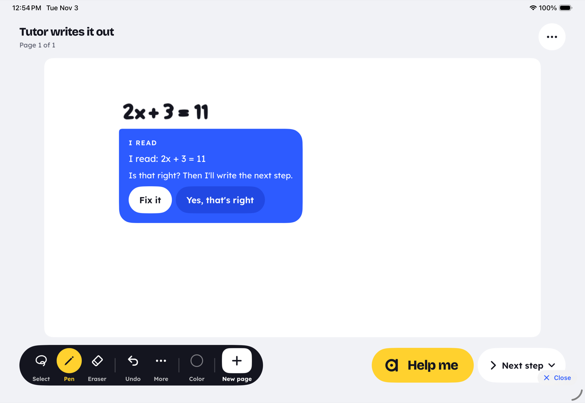
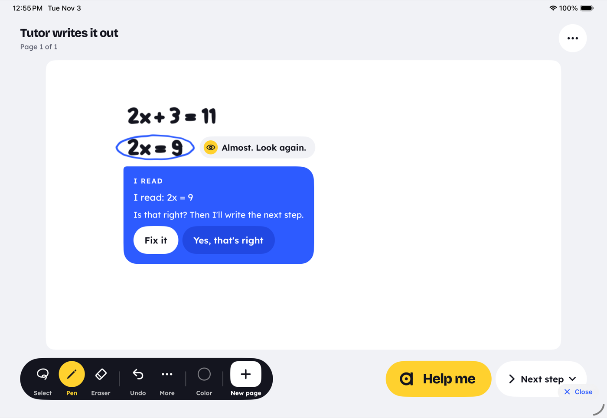

# The tutor writes it out (iPad)

When a kid is stuck and asks, the tutor writes the next step of their work on the board. It writes in
its own cobalt hand (`#2D5BFF`), live, stroke by stroke, the way a teacher works at a whiteboard. It
writes one step per ask, and every step is checked as right before it is written.

Screenshots (synthetic boards, Tutor Writes Lab): [`docs/tutor-writes/`](tutor-writes/).

| | |
|---|---|
|  |  |
|  |  |
|  |  |
|  |  |

## What a kid sees

1. They write `2x + 3 = 11` and get stuck. They tap **Help me**.
   - On **Next step**, Help me goes straight to the step.
   - On **Hint** (the default), Help me first gives a hint card. Its **Show me** button goes to the
     step.
2. On a free board, the first time, the tutor reads their problem back before it writes anything:
   "I read: 2x + 3 = 11. Is that right? Then I'll write the next step."
   - **Yes, that's right** lets the tutor write.
   - **Fix it** opens "Fix what I read". The step is then written from the fixed line.

   See [the messy-handwriting guard](#the-messy-handwriting-guard).
3. Within about a second, the tutor's pen starts writing `2x = 8` under their work in cobalt. Its `=`
   sits under their `=`, at their size, at the pen's natural pace.
4. A tutor card beside the step says why ("Subtract 3 from both sides."). It has **Got it** and
   **Next step** buttons.
5. **Next step** writes the step after the tutor's own. When the step left is the final answer, the
   card says "One step left: divide both sides by 2. You can do this one." and nothing is written.
   If the grown-ups allow answers, that card has a **Show the answer** button. Only that further ask
   writes `x = 4`.
6. The steps are ordinary board ink. The kid can keep writing right below them, or rub them out. The
   next ask carries on from whatever is on the page.

## Triggers

| Ask | What it does |
|---|---|
| Help me on Next step | Writes one step (`LiveLoop.escalate` → `showNextStep`) |
| Show me on any hint card (after a hint, or after a ring on a slip) | Writes one step (`moreHelp` → `escalate`). The button was "More help". |
| Next step on the tutor's step card | Writes the following step |
| Show the answer on the "One step left" card | Writes the final answer, only if the grown-ups allow answers |
| Ask: "what's next?" (`help_board` step) | Help me, as above |
| A long stall (Auto on): 6 s on Next step, 25 s on a problem page on Hint | An **offer** card ("Stuck? I can write the next step for you."), with Not now and Show me. Nothing is written until the kid taps it. Once per state of the work. |

"Solve it" (Solve on the dial) still writes the rest of the problem, as before.

## Rules

- **One step.** The step that comes after the kid's last right line, placed where it belongs:
  - Under the work, with its `=` lined up under the line above's `=`. The kid's `=` is found in their
    ink as two short level strokes; the tutor's own steps carry `tutorEquals`.
  - After the kid's own `=` when their line ends with one (`\frac{1}{2} + \frac{1}{3} =`).
  - Beside the ring when the last line is a slip. The step is the one that should have been written
    there.
- **Shapes.** Each comes from `src/lib/live/tutorStep.ts` or `stackStep.ts`, through the brain:
  - **Equations** (`2x + 3 = 11`, `3(x - 2) = 12`, `5x - 7 = 2x + 8`, `\frac{x}{3} + 2 = 5`): the
    engine's own teacher-style solve. The why is read off the two lines: subtract or add on both
    sides, divide or multiply both sides, multiply out the brackets, combine like terms.
  - **Fractions:** the classroom steps.
    - Adding or subtracting: a common denominator, then the numerators, then simplify.
    - Multiplying: multiply across.
    - Dividing: flip and multiply.
    - Mixed numbers are written as fractions first.
  - **Products across the line** (`46 \times 23 =`): split by place value, multiply the parts, then
    add them.
  - **Column addition, subtraction and × by one digit:** the next column's digit under the rule, and
    its carry, small, over the next column (unless the kid wrote the carry). A borrow is said in words
    ("2 is less than 7, so borrow 1 from the tens. 12 - 7 = 5."). A wrong digit gets the right one
    under it.
  - **Long multiplication:** one row at a time ("Tens row: 46 × 20 = 920. The 0 holds the ones
    place."), then a rule, then the rows added column by column.
- **The answer is held back.** A step that is the final answer is written only on a further ask, and
  only when the grown-ups allow answers. The grown-ups allow answers with Solve it on the dial, or
  with "Show the answer when I write =". Otherwise the card says what to do, never the answer itself.
  This applies to `x = 4`, to `\frac{5}{6}`, and to a column sum's last column.
- **No AI chrome.** No spinner, pill or "thinking" state. The progress is the pen starting to move.
  The why sits on the tutor's existing cobalt card, which already has a read-aloud button.

## Accuracy: what is checked, and what is refused

- Every candidate step is checked by the engine (brain.js, `checkStep`) before it is written:
  - A relation must follow from the line it comes after. That means `analyzeLine` with that line as
    `previous` gives verdict `ok`.
  - `= …` must equal the expression it continues.
  - The step must be new: never a line already on the page, and never "no change".
- If the engine has no step it can vouch for, the model may propose one (`/api/live/solve`, from the
  last right line). That step is written only if the engine checks it too. A model step that does
  not follow is dropped.
- If nothing passes, nothing is written. The card says: "I'm not sure of the next step here, so I
  won't guess. Try a hint, or ask me in Ask."
- On a stacked sum:
  - A read the board isn't sure of (confidence under 0.85), a block it cannot line up, or a slip in
    long multiplication's rows gets words only. A slip in the rows gets its note, never digits.
  - A sum it cannot work gets "I can't line up these columns for sure…".

## The messy-handwriting guard

On real kids' ink about 75% of lines are read right. A misread can turn into a checked step for the
wrong problem. For example, `2x + 3 = 11` read as `2x + 3 = 17` would get `2x = 14`, written in the
tutor's own pen. That is worse than no help. So before any step, the tutor checks the lines the step
rests on (`guardWork` in `tutorStep.ts`). When it is not sure of one, it reads that line back
("I read: … Is that right?") and writes nothing yet.

The readback uses what the tutor already has:

- the "I read" read state (`readingState`): a Mathpix confidence under 0.99, the second opinion
  disagreeing (`RECOGNIZE_SECOND_OPINION`), a look-alike letter, or an unread line;
- the kid's own confirmation or fix;
- "Fix what I read".

**Fix it** opens the fix sheet. **Yes** confirms the read. Either way, the tutor then writes from
the confirmed line (`pendingShowMe`).

1. **A doubtful read** of any line of the kid's is read back first.
2. **The anchor is the problem.**
   - On a problem page, or wherever the tutor gave the problem, the anchor is the tutor's problem.
   - On a free board, it is the kid's first line. That line is read back once (unless the kid has
     already confirmed it) before the first step is written from it.
3. **Every later line is held to the anchor.**
   - An equation must have the same solutions (the engine's verdict with the anchor as `previous`).
   - An expression must have the same value: numbers exactly, a one-letter expression at sample
     values.
   - A line that differs is read back. If the kid says that IS what they wrote, it is a slip, and the
     right step goes beside it.
   - A relation the engine cannot hold to the problem (`5x = 2y` under `5x - 4 = 21`) is read back.
   - Anything else it cannot place (a misread operation line, a side calculation) is never what the
     step goes on from.
4. **Free board.** The tutor writes only when the problem line is confirmed and the chain agrees
   with it.
5. **Column steps.** The rows as read must fit the ink:
   - each row has as many glyphs as digits read (one more for the operator), each digit sits in its
     column, and the answer row's glyphs match its digits;
   - if not (a digit read twice, a carry merged into a row, two digits touching), there are words
     only and no digits;
   - on a problem page the rows' numbers and operator must be the problem's, or the sum is read back;
   - on a free board the sum is read back once ("I read: 286 + 680").
6. **Not guarded.** A problem of more than one line (a system, or givens) has no single anchor. It
   keeps the doubtful-read readback and the engine's own column judging.
7. **Rewrite chains.** A chain of rewrites of one expression in a letter (`3x + 6x - 5 = 9x - 5`) is
   simplified, or left as finished. It is never "solved" as an equation. The real-ink replay found
   that this produced nonsense steps before.

**Measured, messy synthetic slice** (`TutorWritesMessyTests`). The six scenarios are equation (free
board and problem page), fractions, column addition (free and page) and long multiplication. They
ran in six synthetic hands (clean, the scoreboard's messy, shaky, huge, tiny, jaggy), each read right
and with one digit swapped and read with no doubt. That is 72 runs, with a kid who answers each
readback truthfully.

| | First answer to Help me | Steps written | Wrong for the true problem |
|---|---|---|---|
| Read right (36 runs) | step 5, readback 23, last step held 6, words only 2 | 96 | **0** |
| Misread (36 runs) | step 0, readback 34, words only 2 | 96 | **0** |

The 2 words-only runs in each row are the shaky hand's stacked sums: the rows didn't fit the ink.

**Measured, real kids' reads** (`tutorStep.realink.test.ts`, `AGATHON_REALINK=1`). This replays a past
real-ink bench run's cached reads, with no calls. It asks after every line of 198 attempts (stacked
sums are left out because they need the ink), and every read counts as sure, which is the hardest
case. Only aggregate numbers are reported; the corpus stays outside the repo.

- 282 asks: 41 steps written, 87 read back, 26 last steps held, and 128 with nothing written
  (54 already solved, 65 with no step the engine can vouch for, 9 with nothing to go on).
- **0 written steps wrong for the labeled truth.** 14 steps were written on work that had a misread
  somewhere; each was right, because the misread line was read back or set aside.
- Without the guard: 70 steps written, 1 wrong.

## Where the code is

| Piece | File |
|---|---|
| Step choice, fraction and product steps, the check, why | `src/lib/live/tutorStep.ts` (vitest: `__tests__/tutorStep.test.ts`) |
| Stacked sums: next column, carry, long multiplication | `src/lib/live/stackStep.ts` (vitest: `__tests__/stackStep.test.ts`) |
| Brain methods `tutorStep`, `checkStep`, `stackStep` | `src/lib/brain/index.ts`, `brain.js` rebuilt; Swift: `AgathonBrain/TutorWrites.swift` |
| The loop: asks, placement, writing, cards, offer | `AgathonLive/Loop/LiveLoop+TutorWrites.swift` |
| Hooks | `LiveLoop+Help.swift`: `escalate` → `showNextStep`, `moreHelp` by the card's action, `autoStuck` offers instead of writing |
| Card button | `HintCard.action`, `HintCardView` (Next step / Show the answer / Not now) |
| Demo | Debug `Tutor Writes Lab` (`-lab tutorWrites -tutorWritesDemo equation\|fractions\|column\|long\|slip`). It uses a stand-in reader, so it needs no server and spends no money. |
| Guard | `guardWork`, `sameAsAnchor` (`tutorStep.ts`); `rowsMatchInk`, `problemNumbers` (`stackStep.ts`); the readback card and resume (`LiveLoop+TutorWrites.swift`); hooks in `confirmReading` / `useReading` (`LiveLoop+Fix.swift`) |
| Tests | `AgathonLiveTests/TutorWritesLoopTests`, `TutorWritesMessyTests`, `AgathonBrainTests/TutorWritesTests`, `AgathonUITests/TutorWritesUITests`, vitest `tutorStep.test.ts`, `stackStep.test.ts`, `tutorStep.realink.test.ts` (opt-in) |

The meta on the tutor's strokes:

- `tutorStep`: the step's LaTeX.
- `tutorStepId`: one id per step.
- `tutorWhy`: the card's words.
- `tutorInline`: the kid's line the step was written after.
- `tutorEquals`: the x of the step's `=`.
- `stackFor` and `stackPart`: the sum and the place (`a2`, `c3`, `f1`, `r1`, `rule`, `s0`).

## Not done yet

- Long multiplication's row sum writes no carry marks; its why says the carry instead.
- Borrow marks (crossing out a digit and writing it smaller) are said in words, not drawn.
- Decimal points are not written into a column answer.
- The why is shown on the card. It is read aloud only when the kid taps the speaker.
- The 25 s stall offer uses the loop's Auto. With Auto off there is no offer.
