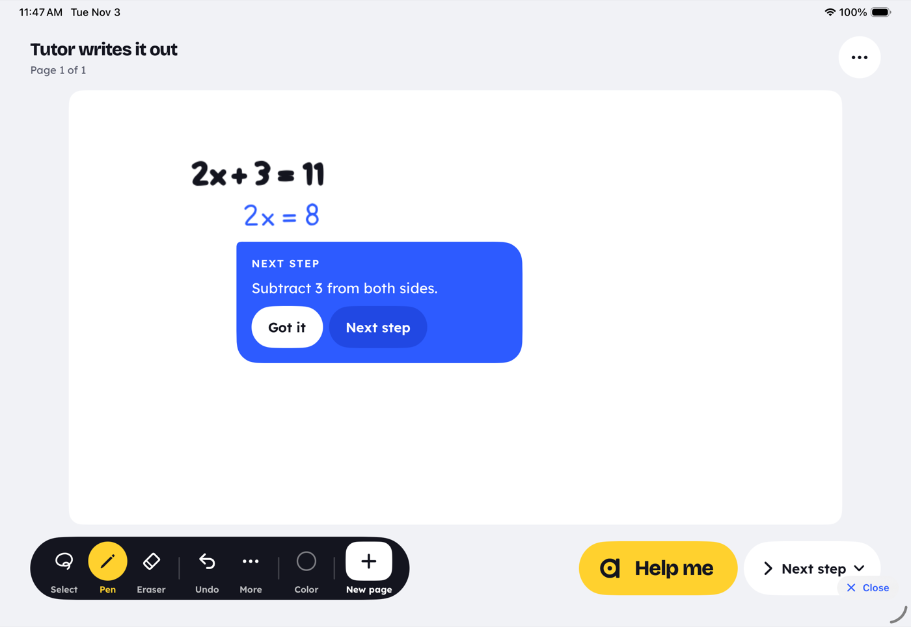
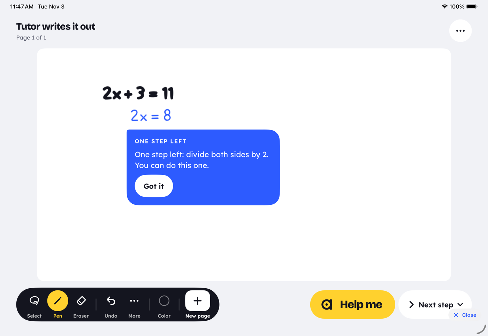
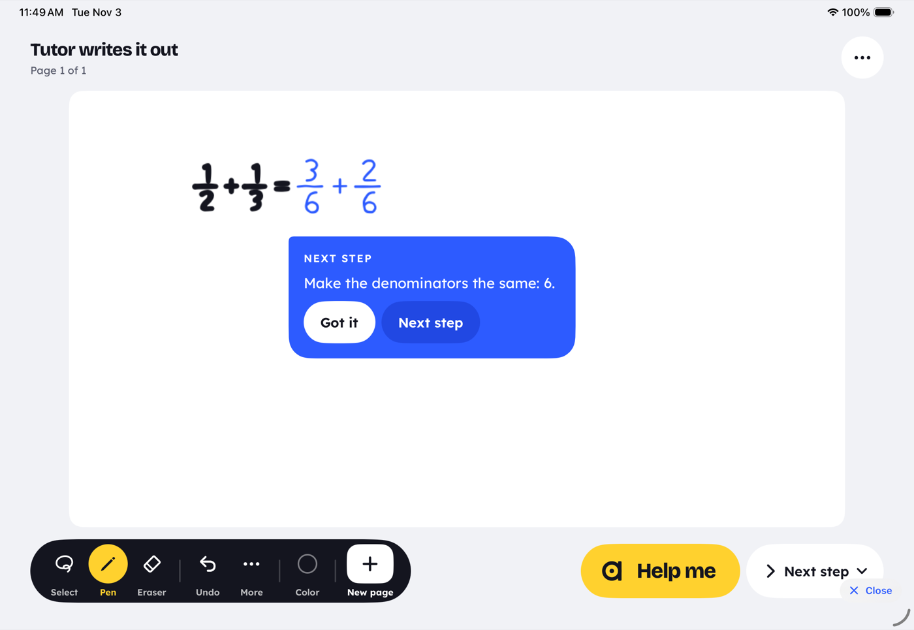
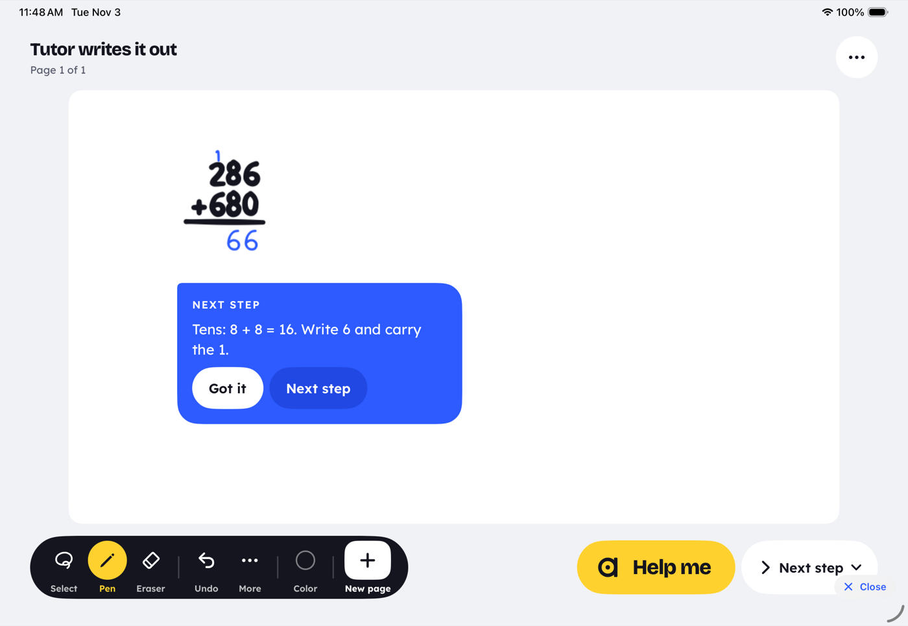
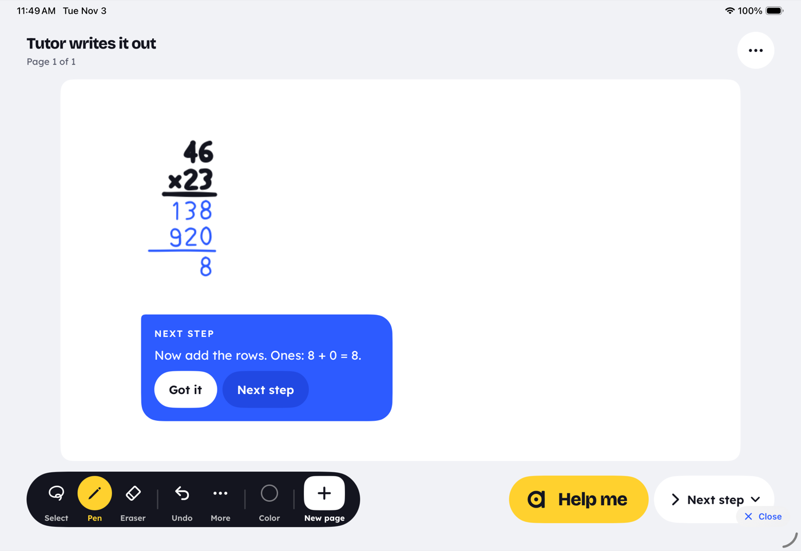

# The tutor writes it out (iPad)

When a kid is stuck and asks, the tutor writes the next step of their work on the board. It writes in
its own cobalt hand (`#2D5BFF`), live, stroke by stroke, the way a teacher works at a whiteboard. It
writes one step per ask, and every step is checked as right before it is written.

Screenshots (synthetic boards, Tutor Writes Lab): [`docs/tutor-writes/`](tutor-writes/).

| | |
|---|---|
|  |  |
|  |  |
|  |  |

## What a kid sees

1. They write `2x + 3 = 11` and get stuck. They tap **Help me**.
   - On **Next step**, Help me writes the step straight away.
   - On **Hint** (the default), Help me first gives a hint card. Its **Show me** button writes the step.
2. Within about a second, the tutor's pen starts writing `2x = 8` under their work in cobalt. Its `=`
   sits under their `=`, at their size, at the pen's natural pace.
3. A tutor card beside the step says why ("Subtract 3 from both sides."). It has **Got it** and
   **Next step** buttons.
4. **Next step** writes the step after the tutor's own. When the step left is the final answer, the
   card says "One step left: divide both sides by 2. You can do this one." and nothing is written.
   If the grown-ups allow answers, that card has a **Show the answer** button. Only that further ask
   writes `x = 4`.
5. The steps are ordinary board ink. The kid can keep writing right below them, or rub them out. The
   next ask carries on from whatever is on the page.

## Triggers

| Ask | What it does |
|---|---|
| Help me on Next step | Writes one step (`LiveLoop.escalate` → `showNextStep`) |
| Show me on any hint card (after a hint, or after a ring on a slip) | Writes one step (`moreHelp` → `escalate`). The button was "More help". |
| Next step on the tutor's step card | Writes the following step |
| Show the answer on the "One step left" card | Writes the final answer, only if the grown-ups allow answers |
| Ask: "what's next?" (`help_board` step) | Help me, as above |
| A long stall (Auto on): 6 s on Next step, 25 s on a problem page on Hint | An **offer** card ("Stuck? I can write the next step for you."), with Not now and Show me. Nothing is written until the kid taps it. Once per state of the work. |

"Solve it" (Solve on the dial) still writes the rest of the problem, as before.

## Rules

- **One step.** The step that comes after the kid's last right line, placed where it belongs:
  - Under the work, with its `=` lined up under the line above's `=`. The kid's `=` is found in their
    ink as two short level strokes; the tutor's own steps carry `tutorEquals`.
  - After the kid's own `=` when their line ends with one (`\frac{1}{2} + \frac{1}{3} =`).
  - Beside the ring when the last line is a slip. The step is the one that should have been written
    there.
- **Shapes.** Each comes from `src/lib/live/tutorStep.ts` or `stackStep.ts`, through the brain:
  - **Equations** (`2x + 3 = 11`, `3(x - 2) = 12`, `5x - 7 = 2x + 8`, `\frac{x}{3} + 2 = 5`): the
    engine's own teacher-style solve. The why is read off the two lines: subtract or add on both
    sides, divide or multiply both sides, multiply out the brackets, combine like terms.
  - **Fractions:** the classroom steps.
    - Adding or subtracting: a common denominator, then the numerators, then simplify.
    - Multiplying: multiply across.
    - Dividing: flip and multiply.
    - Mixed numbers are written as fractions first.
  - **Products across the line** (`46 \times 23 =`): split by place value, multiply the parts, then
    add them.
  - **Column addition, subtraction and × by one digit:** the next column's digit under the rule, and
    its carry, small, over the next column (unless the kid wrote the carry). A borrow is said in words
    ("2 is less than 7, so borrow 1 from the tens. 12 - 7 = 5."). A wrong digit gets the right one
    under it.
  - **Long multiplication:** one row at a time ("Tens row: 46 × 20 = 920. The 0 holds the ones
    place."), then a rule, then the rows added column by column.
- **The answer is held back.** A step that is the final answer is written only on a further ask, and
  only when the grown-ups allow answers. The grown-ups allow answers with Solve it on the dial, or
  with "Show the answer when I write =". Otherwise the card says what to do, never the answer itself.
  This applies to `x = 4`, to `\frac{5}{6}`, and to a column sum's last column.
- **No AI chrome.** No spinner, pill or "thinking" state. The progress is the pen starting to move.
  The why sits on the tutor's existing cobalt card, which already has a read-aloud button.

## Accuracy: what is checked, and what is refused

- Every candidate step is checked by the engine (brain.js, `checkStep`) before it is written:
  - A relation must follow from the line it comes after. That means `analyzeLine` with that line as
    `previous` gives verdict `ok`.
  - `= …` must equal the expression it continues.
  - The step must be new: never a line already on the page, and never "no change".
- If the engine has no step it can vouch for, the model may propose one (`/api/live/solve`, from the
  last right line). That step is written only if the engine checks it too. A model step that does
  not follow is dropped.
- If nothing passes, nothing is written. The card says: "I'm not sure of the next step here, so I
  won't guess. Try a hint, or ask me in Ask."
- On a stacked sum:
  - A read the board isn't sure of (confidence under 0.85), a block it cannot line up, or a slip in
    long multiplication's rows gets words only. A slip in the rows gets its note, never digits.
  - A sum it cannot work gets "I can't line up these columns for sure…".

## Where the code is

| Piece | File |
|---|---|
| Step choice, fraction and product steps, the check, why | `src/lib/live/tutorStep.ts` (vitest: `__tests__/tutorStep.test.ts`) |
| Stacked sums: next column, carry, long multiplication | `src/lib/live/stackStep.ts` (vitest: `__tests__/stackStep.test.ts`) |
| Brain methods `tutorStep`, `checkStep`, `stackStep` | `src/lib/brain/index.ts`, `brain.js` rebuilt; Swift: `AgathonBrain/TutorWrites.swift` |
| The loop: asks, placement, writing, cards, offer | `AgathonLive/Loop/LiveLoop+TutorWrites.swift` |
| Hooks | `LiveLoop+Help.swift`: `escalate` → `showNextStep`, `moreHelp` by the card's action, `autoStuck` offers instead of writing |
| Card button | `HintCard.action`, `HintCardView` (Next step / Show the answer / Not now) |
| Demo | Debug `Tutor Writes Lab` (`-lab tutorWrites -tutorWritesDemo equation\|fractions\|column\|long\|slip`). It uses a stand-in reader, so it needs no server and spends no money. |
| Tests | `AgathonLiveTests/TutorWritesLoopTests`, `AgathonBrainTests/TutorWritesTests`, `AgathonUITests/TutorWritesUITests` |

The meta on the tutor's strokes:

- `tutorStep`: the step's LaTeX.
- `tutorStepId`: one id per step.
- `tutorWhy`: the card's words.
- `tutorInline`: the kid's line the step was written after.
- `tutorEquals`: the x of the step's `=`.
- `stackFor` and `stackPart`: the sum and the place (`a2`, `c3`, `f1`, `r1`, `rule`, `s0`).

## Not done yet

- Long multiplication's row sum writes no carry marks; its why says the carry instead.
- Borrow marks (crossing out a digit and writing it smaller) are said in words, not drawn.
- Decimal points are not written into a column answer.
- The why is shown on the card. It is read aloud only when the kid taps the speaker.
- The 25 s stall offer uses the loop's Auto. With Auto off there is no offer.
